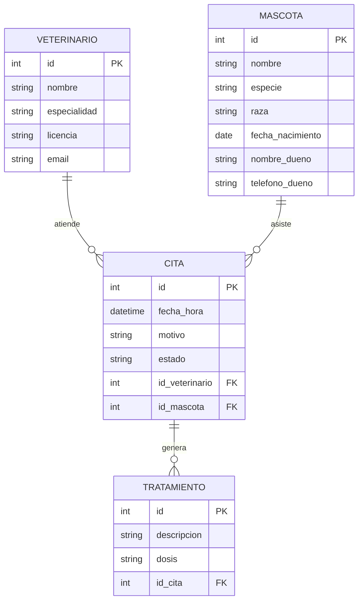

# 🚀 [VetPets] API

## 📖 Descripción del Proyecto
VetPets API es una interfaz RESTful diseñada para digitalizar la gestión integral de una clínica veterinaria. Centraliza el control de pacientes, profesionales especializados, agendamiento de citas y trazabilidad de tratamientos, eliminando el uso de fichas en papel y optimizando la atención médica.

### 💡 Elevator Pitch y Objetivos
* **¿Qué es?:** Una API REST diseñada para digitalizar y automatizar la gestión operativa de una clínica veterinaria. 
* **¿Para quién es?:** Veterinarios, recepcionistas y dueños de mascotas que interactúan con el sistema de la clínica. 
* **¿Qué problema resuelve?:** Centraliza la información de los pacientes (mascotas), el historial clínico, el agendamiento de citas y la prescripción de tratamientos, eliminando el uso de fichas en papel y optimizando los tiempos de atención. 

## 🎥 Video de Presentación
* 🎬 **Enlace al video de presentación (Máx. 5 minutos):** []

## 👥 Equipo de Desarrollo
| Nombre | Rol | GitHub |
|---|---|---|
| Miguel agudelo | [Arquitecto de Software / Backend] | [agudelomiguel803-pixel](https://github.com/agudelomiguel803-pixel) |
| Samuel moreno | [Desarrollador Backend / Database] | [12vasquezsamuel2006-byte · he/him](https://github.com/12vasquezsamuel2006-byte) |
| Brayan soto | [Desarrollador Backend / QA Tester] | [@usuario]() |
| Miguel Lezcano | [Documentador / Analyst] | [lezcano030408-lab](https://github.com/lezcano030408-lab) |

## 🗃️ Modelo de Datos (Entidades)
El sistema se compone de las siguientes 4 entidades principales y sus relaciones:
1. **VETERINARIO**: Representa al personal médico especializado de la clínica, almacenando su información general, especialidad y número de licencia profesional.
2. **MASCOTA**: Registra los datos del paciente (nombre, especie, raza, fecha de nacimiento) junto con la información de contacto de su dueño.
3. **CITA**: Gestiona las programaciones médicas agendadas entre un veterinario y una mascota, registrando la fecha, hora, motivo y estado de la atención.
4. **TRATAMIENTO**: Almacena las prescripciones, procedimientos clínicos o medicamentos formulados durante una cita médica específica.

### Diagrama Entidad-Relación

## 🔌 Documentación de Endpoints (API Design)
A continuación se detallan los endpoints diseñados bajo estándares RESTful.
Base URL propuesta: `http://api.vetpets.com/v1`

### 
1. Recurso: Veterinarios (`/api/v1/veterinarians`)

| Método | Endpoint | Descripción | Payload (Body) | Respuesta |
| :--- | :--- | :--- | :--- | :--- |
| **GET** | `/api/v1/veterinarians` | Listar todos los veterinarios | N/A | `200 OK` |
| **GET** | `/api/v1/veterinarians/3` | Obtener el veterinario con id=3 | N/A | `200 OK / 404 Not Found` |
| **POST** | `/api/v1/veterinarians` | Registrar un nuevo veterinario | `{ "nombre": "Laura Restrepo", "especialidad": "Cirugía", "licencia": "MV-8842", "email": "laura@vetcare.co" }` | `201 Created` |
| **PUT** | `/api/v1/veterinarians/3` | Actualizar todos los datos del veterinario | `{ "nombre": "Laura Restrepo", "especialidad": "Dermatología", "licencia": "MV-8842", "email": "laura@vetcare.co" }` | `200 OK` |
| **DELETE** | `/api/v1/veterinarians/3` | Eliminar un veterinario | N/A | `204 No Content` |
| **GET** | `/api/v1/veterinarians/3/appointments` | **(Relación)** Citas atendidas por el veterinario 3 | N/A | `200 OK` |

---

###
2. Recurso: Mascotas (`/api/v1/pets`)

| Método | Endpoint | Descripción | Payload (Body) | Respuesta |
| :--- | :--- | :--- | :--- | :--- |
| **GET** | `/api/v1/pets` | Listar todas las mascotas | N/A | `200 OK` |
| **GET** | `/api/v1/pets?especie=perros` | Filtrar mascotas por especie | N/A | `200 OK` |
| **GET** | `/api/v1/pets/12` | Obtener la mascota con id=12 | N/A | `200 OK / 404 Not Found` |
| **POST** | `/api/v1/pets` | Registrar una nueva mascota | `{ "nombre": "Rocky", "especie": "Canino", "raza": "Beagle", "fecha_nacimiento": "2021-03-14", "nombre_dueno": "Carlos Mejía", "telefono_dueno": "3017894512" }` | `201 Created` |
| **PUT** | `/api/v1/pets/12` | Actualizar todos los datos de la mascota | `{ "nombre": "Rocky", "especie": "Canino", "raza": "Beagle", "fecha_nacimiento": "2021-03-14", "nombre_dueno": "Carlos Mejía", "telefono_dueno": "3109998877" }` | `200 OK` |
| **PATCH** | `/api/v1/pets/12` | Actualizar solo el contacto del dueño | `{ "telefono_dueno": "3109998877" }` | `200 OK` |
| **DELETE** | `/api/v1/pets/12` | Eliminar una mascota | N/A | `204 No Content` |

---

### 3. Recurso: Citas Médicas (`/api/v1/appointments`)

| Método | Endpoint | Descripción | Payload (Body) | Respuesta |
| :--- | :--- | :--- | :--- | :--- |
| **GET** | `/api/v1/appointments` | Listar todas las citas médicas | N/A | `200 OK` |
| **GET** | `/api/v1/appointments/{id}` | Obtener una cita específica por ID | N/A | `200 OK` |
| **POST** | `/api/v1/appointments` | Agendar una nueva cita | `{ "fecha_hora": "...", "motivo": "...", "id_veterinario": 3, "id_mascota": 12 }` | `201 Created` |
| **PATCH** | `/api/v1/appointments/{id}` | Modificar el estado de una cita | `{ "estado": "cancelada" }` | `200 OK` |
| **DELETE** | `/api/v1/appointments/{id}` | Cancelar/Eliminar una cita | N/A | `204 No Content` |
| **GET** | `/api/v1/appointments/{id}/treatments` | **(Anidado)** Consultar tratamientos generados en una cita | N/A | `200 OK` |

---

### 4. Recurso: Tratamientos (`/api/v1/treatments`)

| Método | Endpoint | Descripción | Payload (Body) | Respuesta |
| :--- | :--- | :--- | :--- | :--- |
| **GET** | `/api/v1/treatments` | Listar todos los tratamientos aplicados | N/A | `200 OK` |
| **GET** | `/api/v1/treatments/{id}` | Obtener un tratamiento por ID | N/A | `200 OK` |
| **POST** | `/api/v1/treatments` | Registrar un tratamiento asociado a una cita | `{ "descripcion": "...", "dosis": "...", "id_cita": 5 }` | `201 Created` |
| **PUT** | `/api/v1/treatments/{id}` | Actualizar información de un tratamiento | `{ "descripcion": "...", "dosis": "..." }` | `200 OK` |
| **DELETE** | `/api/v1/tratments/{id}` | Eliminar un registro de tratamiento | N/A | `204 No Content` |
| **PATCH** | `/api/v1/tratments/18` | Ajustar únicamente la dosis | `{ "dosis": "1 una tableta cada 24 horas" }` | `200 OK` |

## 🛠️ Stack Tecnológico Propuesto
* **Lenguaje:** JavaScript (Node.js)
* **Framework:** Express.js
* **Base de Datos:** PostgreSQL / MySQL
* **Autenticación:** JWT (JSON Web Tokens)

## 📅 Roadmap / Próximos Pasos
1. Configurar entorno de desarrollo.
2. Crear migraciones de base de datos basadas en el ER.
3. Implementar controladores para los endpoints GET.

## 🔗 Enlaces
* **Repositorio GitHub:** [https://github.com/agudelomiguel803-pixel/api-design-VetPets.git]
* **Video de Presentación:** []
* **Organización del equipo:** N/A (Coordinación directa del equipo)
